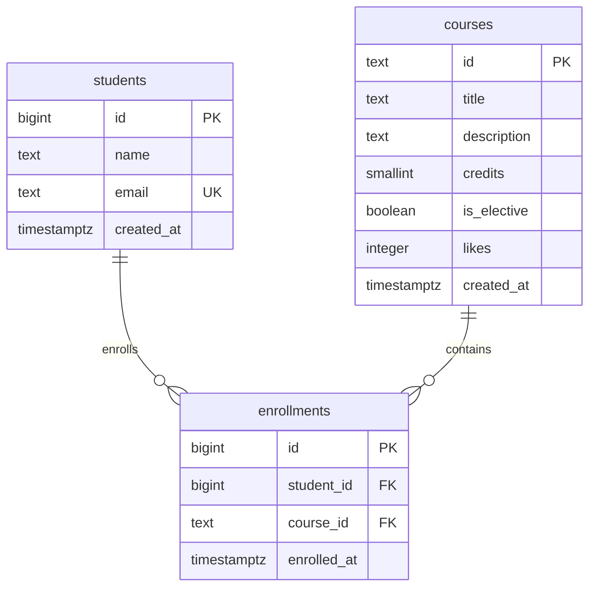

# Lab 6 — Design and create the catalog database

Лабораторная работа №6. PostgreSQL, проект Course Catalog.

Исходные данные: все шесть курсов из `../data.py`. Три постоянные таблицы: `courses`, `students`, `enrollments`. Проверено на PostgreSQL 17.4; фактический вывод находится в `results/`.

## Быстрый запуск на этом компьютере

PostgreSQL установлен в `C:\Program Files\PostgreSQL\17\bin`. Из папки `course-catalog-api`:

```powershell
powershell -ExecutionPolicy Bypass -File .\lab6\start-local.ps1
```

Скрипт создаёт отдельный локальный кластер в `lab6/.lab6-local/data`, запускает его только на `127.0.0.1:55436`, создаёт роль и БД, выполняет все задания. Установка Windows-службы не нужна. Повторный запуск сохраняет существующие данные и выводит курсы. Сгенерированные пароли находятся в `lab6/.lab6-local/connection.json`; эта папка исключена из Git. Не включайте её в сдаваемый архив. Если порт занят, при первом запуске добавьте `-Port 55437`.

Остановить этот сервер:

```powershell
powershell -ExecutionPolicy Bypass -File .\lab6\start-local.ps1 -Stop
```

Подключиться через psql после запуска:

```powershell
$c = Get-Content .\lab6\.lab6-local\connection.json -Raw | ConvertFrom-Json
$env:PGPASSWORD = $c.appPassword
& 'C:\Program Files\PostgreSQL\17\bin\psql.exe' -h 127.0.0.1 -p $c.port -U catalog_app -d catalog_lab6
Remove-Item Env:PGPASSWORD
```

## 1. Роль и база данных

`bootstrap.sql` создаёт `catalog_app` с LOGIN, без SUPERUSER, CREATEDB и CREATEROLE, и БД `catalog_lab6`, владельцем которой является эта роль. Пароль берётся из `CATALOG_DB_PASSWORD`, а не хранится в SQL. Для запуска на уже работающем сервере (административный пароль будет запрошен psql):

```powershell
$env:CATALOG_DB_PASSWORD = 'replace-with-your-own-password'
& 'C:\Program Files\PostgreSQL\17\bin\psql.exe' -X -h 127.0.0.1 -U postgres -d postgres -f .\lab6\bootstrap.sql
$env:PGPASSWORD = $env:CATALOG_DB_PASSWORD
powershell -ExecutionPolicy Bypass -File .\lab6\run-lab6.ps1
Remove-Item Env:PGPASSWORD
Remove-Item Env:CATALOG_DB_PASSWORD
```

`bootstrap.sql` запускается один раз. При уже существующих роли или БД он завершится ошибкой, сохранив их. `run.sql` тоже рассчитан на пустую БД: `CREATE TABLE` не скрывает несовместимую существующую схему.

## 2. Схема и ER-диаграмма



Уникальная пара `(student_id, course_id)` запрещает повторную запись. Идентификаторы студентов и записей — `GENERATED BY DEFAULT AS IDENTITY`; курс сохраняет строковый slug из проекта. Время хранится в `timestamptz`. `NOT NULL` задан для каждого обязательного поля. Проверки: slug, непустое название до 200 символов, credits от 1 до 10, likes >= 0, имя от 2 до 100 символов, email в нижнем регистре без пробелов с простой проверкой формата. Такая проверка email не подтверждает существование почтового ящика. Внешние ключи используют `ON DELETE RESTRICT`.

В psql из этой папки:

```sql
\i schema.sql
\i seed.sql
\dt
\d courses
\d students
\d enrollments
```

## 3. Начальные данные

`seed.sql`: 6 курсов из `data.py`, 3 студента и 4 записи. Сумма исходных likes = 122, elective-курсов = 2. Два проверочных SELECT показывают курсы и записи с JOIN. Повторное заполнение не создаёт дубликаты и не сбрасывает накопленные likes (`ON CONFLICT DO NOTHING`). Оно не предназначено для восстановления вручную изменённых полей. Полное совпадение шести исходных полей каждого курса проверено отдельно: `results/09-data-parity.txt`.

## 4. SQL для маршрутов API

`queries.sql` содержит параметризованные `PREPARE`/`EXECUTE` и воспроизводимые примеры:

| Маршрут | Действие SQL |
| --- | --- |
| GET /courses | Boolean-фильтр, title/popular, LIMIT/OFFSET, id для устойчивого порядка |
| GET /courses/{id} | SELECT по первичному ключу; 0 строк → 404 |
| POST /courses/{id}/like | Атомарный `likes = likes + 1`, RETURNING; 0 строк → 404 |
| POST /enrollments | UPSERT студента по email и INSERT записи в одном statement |
| GET /enrollments | JOIN всех трёх таблиц |
| GET /statistics | LEFT JOIN, COUNT, GROUP BY, SUM и AVG |

API должен валидировать `sort`, `page` и `page_size` до запроса: `sort` = popular/title, page >= 1, page_size от 1 до 100; offset = (page − 1) × page_size. Привязка значений идёт через параметры драйвера. Для больших выборок лучше иметь отдельный подготовленный запрос для каждого сочетания фильтра и сортировки: универсальный CASE/OR может мешать выбору индекса. Индекс в пункте 6 показан для специализированного запроса.

Для нормализованного студента нужен `studentEmail` вместе с `studentName`: имена не уникальны. В SQL имя существующего студента обновляется при совпадении email. Примеры изменяющих запросов откатываются и сохраняют исходные данные.

**Граница задания:** подготовлен SQL для API, как требует пункт 4 слайда. `../main.py` остаётся работающим вариантом Lab 5 с хранением в памяти. Подключение драйвера PostgreSQL, изменение JSON-запроса записи и реализация нового HTTP-маршрута статистики не входят в эту SQL-лабораторную. HTTP-коды ниже — предлагаемая политика будущего обработчика, а не ответы запущенного API.

## 5. Нарушения ограничений и SQLSTATE

Запуск `\i constraints.sql` намеренно нарушает каждый PK/UNIQUE/FK/CHECK и NOT NULL каждого столбца: всего 32 теста. Временная PL/pgSQL-функция перехватывает реальную ошибку и сравнивает SQLSTATE и имя ограничения (для NOT NULL — имя столбца). Неожиданное отсутствие ошибки или другой код останавливает выполнение. В конце выводятся таблица результатов и системный список ограничений для сверки; тестовые объекты откатываются.

| Ситуация | SQLSTATE | Предлагаемый HTTP |
| --- | --- | --- |
| NULL обязательного поля | 23502 | 422 Unprocessable Entity |
| Некорректный slug/title/credits/likes/name/email | 23514 | 422 Unprocessable Entity |
| Повтор PK/email/пары студент-курс | 23505 | 409 Conflict |
| Несуществующий студент или курс при INSERT | 23503 | 404 Not Found |
| Удаление используемого курса/студента | 23503 | 409 Conflict |

Один SQLSTATE может соответствовать разным HTTP-кодам в зависимости от операции. В обработчике нужно сначала откатить транзакцию и затем вернуть понятный JSON; не отправлять клиенту внутренний SQL и текст ошибки сервера. Предварительный SELECT не заменяет ограничения: параллельный запрос может изменить данные между проверкой и записью.

## 6. Индекс и EXPLAIN до/после

`indexes.sql` добавляет 100 000 искусственных курсов внутри транзакции, выполняет ANALYZE и сравнивает один SELECT с `EXPLAIN (ANALYZE, BUFFERS)` до и после:

```sql
CREATE INDEX courses_elective_popular_idx
ON courses(is_elective, likes DESC, id ASC);
```

Запрос выбирает elective-курсы и первые 20 по популярности. Временные данные и экспериментальный индекс откатываются; после этого скрипт создаёт постоянный индекс в исходной базе. Индекс `enrollments(course_id)` помогает JOIN/проверке FK: уникальный индекс `(student_id, course_id)` уже покрывает поиск по student_id, но не по course_id. На шести строках Seq Scan может быть оптимальнее индекса, поэтому эксперимент использует достаточно данных. Настройки планировщика принудительно не отключаются.

Фактическое измерение на 100 006 строках: до индекса — `Seq Scan` + `Sort`, 5.459 ms и 1031 shared buffer hit; после — `Index Scan`, 0.065 ms и 20 hit + 3 read. Это результат одного запуска, а не гарантия ускорения на любой машине.

Полные реальные планы: `results/06-indexes.txt`. Они зависят от машины и кеша. Для повторного эксперимента в учебной БД сначала выполните `DROP INDEX courses_elective_popular_idx; DROP INDEX enrollments_course_id_idx;`, затем `\i indexes.sql`. Эти DROP удаляют только созданные в этой лабораторной индексы, данные сохраняются.

## 7. Транзакции

`transactions.sql` сначала делает успешный COMMIT студента и записи, показывает JOIN и удаляет демонстрационные строки. Затем начинает новую транзакцию, вставляет студента и пытается записать его на отсутствующий курс. Получает реальный SQLSTATE 23503, выполняет ROLLBACK и проверяет пять условий: ожидаемый код, отсутствие студента, отсутствие записи и неизменность обоих счётчиков строк. Пропуски identity после отката допустимы: значения sequence не откатываются.

В stderr этого примера **ожидается одна ошибка FK**. `ON_ERROR_STOP` временно выключен ровно вокруг неё, затем восстановлен; последующие проверки завершают скрипт с ошибкой при неправильном результате.

## 8. Состав и проверка

`bootstrap.sql`, `schema.sql`, `seed.sql`, `queries.sql`, `constraints.sql`, `transactions.sql`, `indexes.sql`, `verify.sql`; `run.sql` объединяет их через `\ir` относительно собственного расположения. `run-lab6.ps1` запускает их на указанной БД; `start-local.ps1` подготавливает отдельный локальный сервер. Все SQL-файлы сохраняются в UTF-8.

В `results/` сохранены результаты настоящего выполнения с ролью `catalog_app`, не суперпользователем. Финальная проверка: ровно 3 таблицы, 6 курсов, 3 студента, 4 записи, 122 likes, без оставшихся benchmark/demo-строк. Повторное заполнение и сохранение изменённых likes проверены отдельно.

Все файлы лабораторной находятся в папке `lab6/` существующего репозитория API. Для сдачи добавьте эту папку в Git и отправьте изменения в свой репозиторий; публикация автоматически не выполнялась.

Документация: [PostgreSQL 17 — SQLSTATE](https://www.postgresql.org/docs/17/errcodes-appendix.html), [EXPLAIN](https://www.postgresql.org/docs/17/sql-explain.html).
